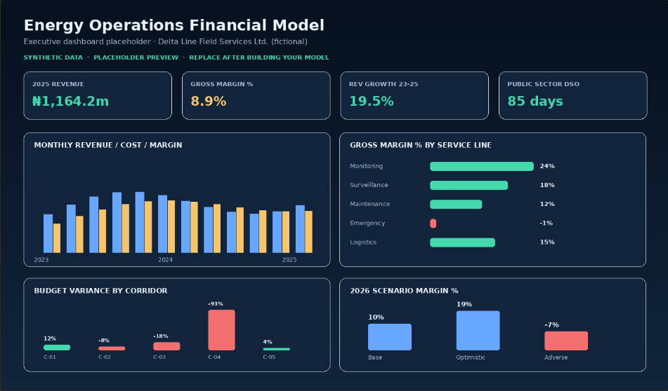

<!-- STARTER README for Project 1. Replace placeholders and fill the results sections
     only after you have built and validated your own workbook. -->

# Energy Operations Financial Model

> **Build a refreshable Excel model that explains revenue, margin, budget variance, collections risk, and FX/fuel/downtime sensitivity for a fictional field-operations company.**



[](LICENSE)
[](DATA_NOTICE.md)

**Case:** Delta Line Field Services Ltd. — a fictional Nigerian oil-and-gas field-services company.  
**Actual period:** January 2023 – December 2025. **Forecast period:** January – December 2026.  
**Data notice:** All company names, corridors, customers, transactions, FX rates, fuel prices, and incidents are synthetic. **No employer or client data is used.** See [`DATA_NOTICE.md`](https://github.com/JedaiahTietie/Energy-Operations-Financial-Model/blob/main/DATA_NOTICE.md).

---

## 1. Business problem

**Stakeholder:** CFO / Finance Director.  
**Decision:** Where to protect margin, which service lines and corridors to reprice or prioritise, and how exposed the 2026 plan is to FX, fuel, downtime, and slow collections.

1. Which service lines and corridors generate revenue and gross margin?
2. Where are actual costs above budget, and which cost accounts drive the variance?
3. How do FX, fuel, and downtime assumptions change 2026 margin?
4. Which customer segments create working-capital risk?
5. What is a defensible 12-month forecast with Base, Optimistic, and Adverse scenarios?

## 2. Dataset provided

| File | Rows | Purpose |
|---|---:|---|
| `data/raw/fact_ledger_raw.csv` | 14,520 | Deliberately messy revenue/cost transactions |
| `data/raw/fact_budget_raw.csv` | 3,845 | Approved monthly budget, 2023–2026 |
| `data/raw/fact_collections_raw.csv` | 4,360 | Invoice payment records |
| `data/raw/macro_factors_raw.csv` | 48 | Monthly FX, diesel, inflation, fuel/downtime indices |
| `data/raw/dim_*.csv` | — | Date, cost centre, service line, account, customer, scenario dimensions |
| `data/expected_clean/` | — | Clean answer-key files and validation summaries |

The raw files contain **intentional** duplicates, missing values, inconsistent text, invalid dates, and `N/A` values. See [`docs/data_quality_issues.md`](https://github.com/JedaiahTietie/Energy-Operations-Financial-Model/blob/main/Screenshot/data_quality_issues.md).

Regenerate everything with:

```bash
python src/generate_synthetic_data.py
```

Validate the raw files and your cleaned export with:

```bash
python src/validate_data.py
```

## 3. What you will build

1. A **Power Query cleaning layer** with documented transformations.
2. A **star-schema data model** or a formula-only equivalent.
3. Measures for revenue, cost, gross margin, budget variance, DSO, forecast, and scenarios.
4. An **executive dashboard** with KPI cards, trend, service-line profitability, corridor variance, collections, and scenario comparison.
5. A **reconciliation sheet** proving the model ties to source control totals.
6. A **one- to two-page executive memo** with findings and recommendations.
7. Complete GitHub documentation.

Two build paths are provided in [`BUILD_GUIDE.md`](BUILD_GUIDE.md):

- **Path A — Power Query + Power Pivot/DAX** (recommended if you have Excel for Windows / Microsoft 365).
- **Path B — Power Query + worksheet formulas** (`SUMIFS`, `XLOOKUP`, `INDEX/MATCH`) for Excel versions without Power Pivot.

## 4. Quick start

```bash
git clone https://github.com/[USERNAME]/excel-energy-ops-financial-model.git
cd excel-energy-ops-financial-model
python src/generate_synthetic_data.py
python src/validate_data.py
```

Then:

1. Open `Financial_Model_Starter.xlsx`.
2. Read `BUILD_GUIDE.md`.
3. Create the `FolderPath` Power Query parameter described in `powerquery/00_Setup.md`.
4. Paste the `.pq` scripts into the Advanced Editor.
5. Build the model and dashboard.
6. Use `solution_reference/Financial_Model_Reference.xlsx` only as a **visual answer key**.
7. Document the project with `DOCUMENTATION_GUIDE.md` and the templates in `docs/`.

> **Important:** `solution_reference/` is a static reference. Do not publish it as your completed model without rebuilding and understanding every calculation.

## 5. Repository structure

```text
excel-energy-ops-financial-model/
├── README.md
├── BUILD_GUIDE.md
├── DOCUMENTATION_GUIDE.md
├── DATA_NOTICE.md
├── LICENSE
├── CHANGELOG.md
├── requirements.txt
├── Financial_Model_Starter.xlsx
├── data/
│   ├── raw/                    # messy source CSVs
│   ├── expected_clean/         # answer key / validation
│   └── processed/              # your cleaned exports
├── src/
│   ├── generate_synthetic_data.py
│   ├── validate_data.py
│   └── build_workbooks.py
├── powerquery/                 # M scripts for cleaning
├── docs/                       # documentation templates and answer key
├── dashboards/                 # your finished .xlsx / PDF output
├── screenshots/                # dashboard previews
└── solution_reference/         # static reference dashboard only
```

## 6. After you finish — replace this section

Your published README must contain:

- One hero screenshot.
- Three **quantified** findings from your workbook.
- Two recommendations.
- The tools and Excel features used.
- Data source, licence/notice, and limitations.
- Reproduction steps.
- A link to the finished `.xlsx`, PDF dashboard, and executive memo.
- A statement that the data is synthetic and no employer data was used.

Use `docs/expected_results.md` to **check** your numbers, not to copy them blindly.

## 7. Documentation included

- [`BUILD_GUIDE.md`](BUILD_GUIDE.md) — step-by-step build instructions.
- [`DOCUMENTATION_GUIDE.md`](DOCUMENTATION_GUIDE.md) — how to document and publish.
- [`docs/data_dictionary.md`](docs/data_dictionary.md)
- [`docs/assumptions.md`](docs/assumptions.md)
- [`docs/kpi_definitions.md`](docs/kpi_definitions.md)
- [`docs/data_quality_issues.md`](docs/data_quality_issues.md)
- [`docs/executive_memo_template.md`](docs/executive_memo_template.md)
- [`docs/limitations.md`](docs/limitations.md)
- [`docs/refresh_instructions.md`](docs/refresh_instructions.md)
- [`docs/github_publishing_checklist.md`](docs/github_publishing_checklist.md)
- [`docs/expected_results.md`](docs/expected_results.md) — answer key.

## Licence

- Code and workbook templates: MIT.
- Documentation: adapt as needed, but retain the synthetic-data notice.
- Datasets: fully synthetic and generated by this repository; no third-party licence applies.

## Contact

Jedaiah Ogheneyerowho Tietie · [LinkedIn] · [GitHub profile] · [professional email]
